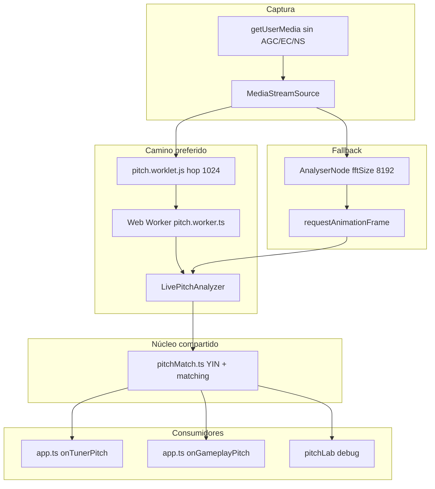

# Afinado y audio en Guitar App

Este documento describe cómo funciona el **afinador**, la **captura de micrófono**, la **detección de pitch** y el **motor de audio sintético** en `guitar-app`. El servidor (`guitar-server`) no interviene en el afinado: todo ocurre en el navegador con Web Audio API.

---

## Vista general



| Pieza | Rol |
|--------|-----|
| `GuitarAudioEngine` (`audioEngine.ts`) | Singleton `guitarAudio`: síntesis, micrófono, listeners de pitch |
| `LivePitchAnalyzer` (`livePitch.ts`) | Filtrado, supresión de ruido, onset/chroma, rate-limit de YIN |
| `detectPitchAutocorrelation` (`pitchMatch.ts`) | YIN + asignación a cuerda abierta / traste (nombre histórico: “autocorrelation”) |
| `App` (`app.ts`) | UI del afinador, estabilización temporal, marcar cuerdas afinadas |
| `SessionAudioProfile` (`sessionProfile.ts`) | Umbrales adaptados tras calibración de sesión (sobre todo gameplay) |

---

## Afinación de referencia

La guitarra está en **afinación estándar** (cuerda 6 → 1):

| Cuerda (`peg` / `data-peg`) | Nota | Frecuencia (Hz) |
|----------------------------|------|-----------------|
| 6 | E2 | 82.41 |
| 5 | A2 | 110.00 |
| 4 | D3 | 146.83 |
| 3 | G3 | 196.00 |
| 2 | B3 | 246.94 |
| 1 | E4 | 329.63 |

Frecuencia en un traste: `f = f_abierta × 2^(traste/12)` (`getFretFrequency` en `audioEngine.ts`).

**Tolerancia “afinada”:** `TUNER_IN_TUNE_CENTS = 5` en `pitchMatch.ts` (±5 cents respecto a la cuerda abierta asignada).

---

## Audio sintético (referencia y feedback)

No se reproducen samples grabados: las cuerdas usan **Karplus-Strong** en `playString()`:

1. Buffer de un período lleno de ruido blanco.
2. `BufferSource` en loop + filtro lowpass (más oscuro en cuerdas graves).
3. Resonador tipo peaking ~180 Hz (cuerpo).
4. Envelope de amplitud exponencial.

Usos en el flujo de afinado:

- **Tocar una clavija** (`activatePeg` con `playSound: true`): suena la cuerda abierta de referencia.
- **`playTunedChime()`**: doble sine (C6/C7) al marcar una cuerda como afinada.
- **`playCompletionFanfare()`**: rasgueo ascendente 6→1 cuando las seis cuerdas están marcadas.

El contexto se crea bajo demanda (`init()`), `masterGain` a 0.7, y `ensureRunning()` reanuda si el `AudioContext` quedó en `suspended` (política de autoplay del navegador).

---

## Micrófono: permisos y rutas de captura

### Permisos y pantallas

- Pantallas que usan micrófono: `tuner`, `notes`, `chords`, `fretboard` (`micScreens` en `app.ts`).
- Al cambiar de vista, `syncMicForScreen()` libera el micrófono si la pantalla no lo necesita, o llama a `attachMicForScreen()`.
- Solo un listener de dominio a la vez: `detachAllMicListeners()` antes de enganchar `onTunerPitch` o `onGameplayPitch`.
- El permiso se recuerda en `sessionStorage` (`guitar_mic_granted`) y en `guitarAudio.hasMicPermission`.

`getUserMedia` pide audio con **echoCancellation, autoGainControl y noiseSuppression en false** para no deformar el pitch ni el nivel.

### Camino A: AudioWorklet + Worker (preferido)

1. `pitch.worklet.js` registra el procesador `pitch-capture`.
2. Acumula muestras en bloques de **1024** y los envía por `port.postMessage`.
3. El micrófono pasa por el worklet; la salida va a un `GainNode` en 0 (audible solo para el grafo, no para el usuario).
4. `pitch.worker.ts` instancia `LivePitchAnalyzer` y por cada `hop` devuelve un `PitchMatchResult` al hilo principal.
5. Los buffers se transfieren con `postMessage(..., [hop.buffer])` para evitar copias.

Si `audioWorklet` no existe o falla al cargar el módulo, se guarda `workletError` y se usa el camino B.

### Camino B: AnalyserNode + `requestAnimationFrame` (fallback)

1. `AnalyserNode` con `fftSize = 8192`, `smoothingTimeConstant = 0`.
2. Cada frame: `getFloatTimeDomainData` sobre el buffer completo.
3. **Solo las muestras nuevas** desde el último frame se pasan a `LivePitchAnalyzer.pushHop()` (misma lógica que el worker; corrige el bug de re-procesar siempre la ventana entera en móviles donde el worklet no arranca).

Ambos caminos comparten el mismo analizador en vivo y el mismo `detectPitchAutocorrelation`.

---

## `LivePitchAnalyzer`: preprocesado y ritmo de análisis

Por cada hop de muestras:

### 1. Filtrado en el dominio del tiempo

- Tres **notch** en 60, 120 y 180 Hz (armónicos de red) con Q estrecho.
- **High-pass** ~70 Hz (pole de un polo) para quitar rumble.

Las muestras filtradas se escriben en un **ring buffer** de 8192 muestras.

### 2. Pitch (YIN), máximo ~33 Hz

- YIN solo se recalcula si pasaron **≥ 30 ms** desde el último cálculo (el onset/chroma sí van a ritmo de hop).
- Ventana para YIN: hasta **4096** muestras (`NOISE_FFT`) del final del ring.
- Antes de YIN: **`suppressStationaryNoise`** (sustracción espectral del piso de habitación).
- Umbral dinámico de RMS: `max(rmsGate, noiseRms × 1.5)` para no silenciar el decay de notas en habitaciones ruidosas.

### 3. Aprendizaje de ruido de sala

Mientras el frame se considera “quieto”:

- Se actualiza `noiseRms` (EMA) y el espectro `noiseMag` (FFT 4096).
- Tras **6 frames quietos**, en frames con señal se resta el piso espectral (gain por bin) y se hace IFFT.

Solo se aprende ruido en silencio real; aprender durante una nota sonando elevaba el piso y hacía desaparecer notas suaves.

### 4. Onset y chroma (gameplay)

- FFT 2048 con ventana Hann → **spectral flux** (subidas de magnitud).
- Onset si flux > `fluxAverage × fluxMultiplier` (con refractory 60 ms).
- **Chroma** 12 bins vía `chromaFromMagnitudes` (`chords.ts`).

El afinador **no usa** onset ni chroma; el gameplay sí (notas + acordes).

---

## `pitchMatch.ts`: YIN y matching a guitarra

A pesar del nombre `detectPitchAutocorrelation`, el estimador de frecuencia es **YIN** (`detectFreqYin`):

- Rango de período: ~75–900 Hz (`minTau` / `maxTau`).
- Umbral CMND 0.15; fallback si no hay dip claro (evita octavas falsas en ruido).
- Guardas de **octava / duodécima por debajo** (período múltiple del real).
- Interpolación parabólica del mínimo CMND para sub-muestra.

### Puerta de silencio y hum

- Si RMS < `rmsGate` → sin pitch (`freq: null`).
- Rechazo si `freq < 75 Hz` o está a **< 1.5 Hz** de 60, 120 o 180 Hz (hum de red; B2 cerca de 120 Hz motivó no usar ventanas más agresivas solo por hum).

### Asignación a cuerda abierta (`stringMatch`)

1. MIDI de la frecuencia medida vs MIDI de cada cuerda abierta → la más cercana.
2. Si la distancia en semitonos > 0.85 y `freq × 2 ≤ 700`, se prueba **plegado de octava** solo para **elegir cuerda** (cuerdas muy desafinadas hacia abajo).
3. `stringMatch` solo existe si la nota está a **≤ 2 semitonos** (`OPEN_STRING_RANGE_SEMITONES`) de alguna cuerda abierta.
4. **Cents mostrados / `inTune`:** respecto a la cuerda asignada, usando `tunerHeard` (frecuencia real oída cuando hay cuerda; no la frecuencia “plegada”). El campo `freq` del resultado es siempre la frecuencia YIN sin plegar (importante para gameplay y tests de octava).

### Asignación a traste (`fretMatch`)

Búsqueda en cuerdas 1–6, trastes 0–15: mejor candidato con |cents| < 45 respecto a la frecuencia esperada (score = |cents| + 0.01×traste). Usado sobre todo en **modo notas** del gameplay cuando la nota no cae cerca de una abierta.

---

## Forma del resultado: `PitchMatchResult`

```ts
{
  freq: number | null;      // Hz medidos (redondeo 0.1)
  rms: number;
  isOnset: boolean;         // ataque detectado
  chroma: Float32Array | null;
  stringMatch: { string, name, targetFreq, cents, inTune } | null;
  fretMatch: { string, fret, expectedFreq, cents } | null;
}
```

---

## Lógica de UI del afinador (`app.ts`)

### Flujo del usuario

1. Primera visita: overlay pide micrófono (`tuner-btn-enable-mic` → `grantMicAndAttach`).
2. Orden sugerido de afinación: cuerdas **6 → 5 → 4 → 3 → 2 → 1** (`tuningOrder`).
3. Las clavijas son `data-peg` 1–6 (coinciden con número de cuerda).
4. Sin micrófono, tocar una clavija solo reproduce la referencia y muestra “Escuchá la nota de referencia”.

### `onTunerPitch`: estabilización antes de mover el medidor

Para evitar saltos entre cuerdas y lecturas espurias:

| Regla | Valor | Efecto |
|--------|--------|--------|
| Estabilidad de cuerda | `tunerMicStableFrames ≥ 120` ms acumulados con la misma `stringMatch.string` | No actualiza UI hasta ~120 ms de la misma cuerda |
| Suavizado de cents | EMA 72% / 28% cuando `activePeg === match.string` | Medidor menos nervioso |
| Rate limit UI | Mínimo **80 ms** entre `activatePeg` | Menos parpadeo |
| Marcar afinada | `|cents| ≤ 5` durante **≥ 280 ms** (`commitTune`) | Check verde + `playTunedChime` |
| Sin señal | > 400 ms sin pitch útil | Reset estado, `tunerMotion.release()` |

`activatePeg(peg, cents, …, vibrate, commitTune)`:

- `--tuner-offset` en el indicador: cents limitados a ±40 para el CSS.
- `commitTune` → `markStringTuned` → auto-avance a la siguiente cuerda sin marcar tras 1.2 s.
- Seis cuerdas → `showTunerComplete()` + `playCompletionFanfare()`.

### Animación

`tunerMotion.ts` añade clase `vibrating` al label de pitch mientras hay lectura estable con vibrate; no anima el mástil por número de cuerda (el parámetro `stringNum` no se usa aún).

---

## Gameplay y calibración (mismo pipeline de audio)

- **`onGameplayPitch`**: publica telemetría (`publishLiveFrame`), y si hay partida activa:
  - Modo **notas**: `handleMicNoteDetected(freq, fretMatch, isOnset)` — los onsets pasan aunque `freq` sea null en el frame del ataque.
  - Modo **acordes**: `handleMicChordDetected` con chroma.
- **`SessionCalibrator`**: durante la calibración intercepta los frames, mide ruido y rasgueos, y `deriveSessionProfile()` ajusta `rmsGate` y `fluxMultiplier`; luego `guitarAudio.applySessionProfile()` los propaga al worker.

El afinador usa el perfil por defecto salvo que ya se haya aplicado un perfil de sesión en la misma instancia del engine.

---

## Herramientas de depuración

| Herramienta | Ubicación | Uso |
|-------------|-----------|-----|
| Panel “Micrófono” en afinador | `tuner-debug-*` en `index.html` + `app.ts` | Waveform, log, grabación WAV 6 s + JSON |
| Pitch Lab | `debug/pitchLab.ts` | Diagnóstico profundo, export JSON |
| `guitarAudio.getDiagnostics()` | `audioEngine.ts` | `path` worklet/analyser, `workletError`, tiempos de loop |

---

## Archivos clave

```
guitar-app/src/audio/
  audioEngine.ts      # Motor, micrófono, síntesis, listeners
  livePitch.ts        # Ring buffer, filtros, ruido, onset, chroma
  pitchMatch.ts       # YIN + stringMatch + fretMatch
  pitch.worklet.js    # Captura hops 1024 en audio thread
  pitch.worker.ts     # LivePitchAnalyzer en worker
  sessionProfile.ts   # Umbrales de sesión
  liveFeed.ts         # Telemetría en vivo (debug)

guitar-app/src/
  app.ts              # onTunerPitch, activatePeg, permisos mic
  components/tunerMotion.ts
  components/gameplay.ts
  components/calibration.ts
  debug/pitchLab.ts
  types/audio.types.ts

guitar-app/src/audio/__tests/
  pitchMatch.test.ts  # Octavas, ruido, fundamentos débiles
  livePitch.test.ts
  audioEngine.test.ts
```

---

## Constantes útiles (referencia rápida)

| Constante | Valor | Archivo |
|-----------|--------|---------|
| `PITCH_WINDOW` | 4096 | pitchMatch |
| `TUNER_IN_TUNE_CENTS` | 5 | pitchMatch |
| `OPEN_STRING_RANGE_SEMITONES` | 2 | pitchMatch |
| Hop worklet | 1024 | pitch.worklet.js |
| Ring buffer | 8192 | livePitch |
| YIN min rate | 30 ms | livePitch |
| Estabilidad afinador | 120 ms | app.ts |
| Tiempo en afinación para check | 280 ms | app.ts |
| `DEFAULT_SESSION_PROFILE.rmsGate` | 0.005 | sessionProfile |
| `DEFAULT_SESSION_PROFILE.fluxMultiplier` | 2.4 | sessionProfile |

---

## Limitaciones conocidas (por diseño)

- El afinador asume **cuerdas abiertas** cerca de la afinación estándar (±2 semitonos); notas en trastes no guían el modo afinador.
- Armónicos fuertes y ruido de red siguen siendo casos borde; hay notch + rechazo de hum + tests de regresión en graves.
- En iOS/Android, el camino **Analyser + rAF** puede tener jitter de timing; el worklet es más estable cuando está disponible.
- `stopMicrophonePitchTracking()` limpia listeners pero **no** suelta el stream; `releaseMicrophone()` detiene tracks y desmonta worklet/analyser.

---

*Generado a partir del código en `guitar-app` (octubre 2026).*
